  <picture>
    <source media="(prefers-color-scheme: dark)" srcset="assets/hero-dark.svg">
    <source media="(prefers-color-scheme: light)" srcset="assets/hero-light.svg">
    
  </picture>

  
  
  
  

## A quick introduction

I'm a software engineer at **IBM**, building interfaces and integrations for **App Connect** — React on the front, Kubernetes and OpenShift underneath. Before that, I spent three years at **Deloitte**, shipping React applications for a Fortune 500 healthcare client.

Outside of work, I build small products for ordinary problems: a whiteboard that opens instantly, a shared note with no sign-up, a cleaner for the storage AI tools leave behind. I care about speed, clarity, and software that gets out of the way.

## Selected work

| Product | What it does | Under the hood |
| :------ | :----------- | :------------- |
| **[Hello Drawing](https://hellodrawing.com)** | A free, browser-first whiteboard. Open it, sketch, and export — no account, no upload, no friction. | React · TypeScript · Excalidraw · IndexedDB |
| **[RealTimeNote](https://realtimenote.com)** | A shared note you open from a link and edit together, instantly. No account or install. | React · TypeScript · Cloudflare Workers |
| **[AgentSweep](https://8080-agqu4klin73vwwocajlburtfcm.instabox.tech/)** preview | A native macOS app that shows what 26 AI tools store on your Mac, so you can decide what to keep. | SwiftUI · Swift 6 · macOS |

More on my **[portfolio](https://mayank-singh.vercel.app)** →

## Toolkit

  
  
  
  
  
  
   
  
  
  
  
  
  

## How I work

- **Start with the interface.** If it isn't clear on first use, the architecture doesn't matter.
- **Keep the stack honest.** The right amount of infrastructure is usually less than you think.
- **Sweat the last 10%.** Fast loads, empty states, keyboard paths, reduced motion — that's where software starts to feel good.

## Let's connect

I'm always up for a conversation about frontend architecture, developer tools, or something you're building.

[Portfolio](https://mayank-singh.vercel.app) · [LinkedIn](https://linkedin.com/in/mayanksingh17) · [Email](mailto:smayankanand3@gmail.com) · [X](https://x.com/MS17092)

Bengaluru, India · Usually shipping from a terminal.
